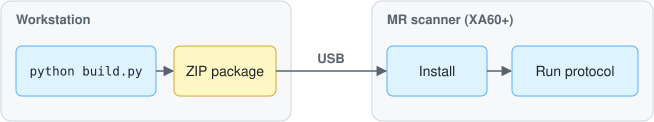

# openrecon-sct

[OpenRecon](https://www.siemens-healthineers.com/magnetic-resonance-imaging/options-and-upgrades/clinical-applications/openrecon) app to run [Spinal Cord Toolbox (SCT)](https://spinalcordtoolbox.com) directly on Siemens MR scanners.

Based on [neuropoly/openrecon-template](https://github.com/neuropoly/openrecon-template), with inspiration from [benoitberanger/openrecon-ants](https://github.com/benoitberanger/openrecon-ants).

> [!WARNING]
> Research use only. Not for diagnostic use.

## Features

| UI parameter | Values | Default |
|---|---|---|
| **SCT command** | `sct_deepseg spinalcord` (contrast-agnostic spinal cord segmentation) | `sct_deepseg spinalcord` |
| **Save original images** | send back the original images (no suffix) | `true` |
| **Save overlay** | send back the original images with the cord contour burned in | `true` |

Output series, for each incoming magnitude series:

| Series | `SequenceDescriptionAdditional` | Content |
|---|---|---|
| original (optional) | – | unchanged input images |
| segmentation | `SCTSeg` | binary spinal cord mask (displayed bright) |
| overlay (optional) | `SCTOverlay` | input images + segmentation contour |

Non-magnitude images (e.g. phase) are passed through unchanged.

### How it works

[app/or-sct.py](app/or-sct.py):

1. Stacks the 2D MRD images into a 3D volume (slices sorted along the slice direction) and builds the NIfTI affine from the MRD geometry (`position`, `read_dir`, `phase_dir`, `slice_dir`, FOV, matrix).
2. Runs the SCT command (`sct_deepseg spinalcord -i ... -o ...`) as a subprocess. SCT lives in its own conda env in the container (`/opt/sct`).
3. Reads the result back, restores the original image order, and sends new MRD series with the original headers.

To add an SCT command: add a choice in [app/or-sct_json_ui.json](app/or-sct_json_ui.json) (`SCTCommand` parameter) and map it in `SCT_COMMANDS` / `process_image()` in [app/or-sct.py](app/or-sct.py).


## Installation

The app is packaged as a `.zip` (Docker image + PDF) on a build workstation, then copied and installed on the MR scanner host.

<p align="center"></p>

### Build

Requirements:
- Python ≥ 3.10 with `jsonschema` (`pip install jsonschema`)
- `git`, `zip`, Docker

```bash
python build.py
```

Options:
- `--sct-version 7.3`: SCT release (git tag) installed in the image
- `--skip-docker-version-check`: build even with Docker ≥ 25. Siemens documents a maximum Docker version (`docker save` format changed in Docker 25), so check that the resulting image loads on your scanner software version.

Output: `build/OpenRecon_NeuroPoly_SCT_V<version>.zip`. **This zip is the file to install on the scanner.**

What [build.py](build.py) does:

1. Clones [python-ismrmrd-server](https://github.com/kspaceKelvin/python-ismrmrd-server) (pinned commit) and builds its Docker image (`python-ismrmrd-server`). This image is the base: the MRD server that talks to the scanner reconstruction pipeline.
2. Validates [app/or-sct_json_ui.json](app/or-sct_json_ui.json) against the OpenRecon schema ([app/OpenReconSchema_1.1.0.json](app/OpenReconSchema_1.1.0.json)).
3. Writes a Dockerfile (`build/OpenRecon_NeuroPoly_SCT_V<version>.Dockerfile`) that:
   - installs SCT (`install_sct`, CPU PyTorch) in `/opt/sct`, and downloads the `sct_deepseg spinalcord` model (the scanner has no internet access);
   - embeds the UI JSON (base64) in the image label `com.siemens-healthineers.magneticresonance.openrecon.metadata:1.1.0`, which is how the scanner discovers the app name, version and UI parameters;
   - copies [app/or-sct.py](app/or-sct.py) and sets it as the default config of the MRD server.
4. Builds the image for `linux/amd64` (the MR host architecture, also on Apple Silicon, where it is slow because of emulation) and saves it with `docker save` to a `.tar`. The image is large (several GB) because of SCT + PyTorch.
5. Generates a small `.pdf` (vendor, name, version), which OpenRecon requires next to the image.
6. Zips the `.tar` and `.pdf`.

To bump the version, edit `version`, `production_identifier` and `material_number` in [app/or-sct_json_ui.json](app/or-sct_json_ui.json): the scanner identifies packages by vendor + id + version.

### Install on the scanner

> [!IMPORTANT]
> Requires the OpenRecon option on the scanner (syngo MR XA60 or later) and appropriate research agreement with Siemens. Coordinate with your MR physicist / Siemens collaboration manager before installing anything on the MR host. The procedure below is the community-documented one (see [neurodesk/openrecon](https://github.com/neurodesk/openrecon)); refer to the official Siemens OpenRecon documentation on [magnetom.net](https://www.magnetom.net) for your software version.

Copy the `.zip` to the MR host (USB stick or network share). **Do not unzip it.** Close any open protocol first (an open protocol can block the installation).

#### XA60 / XA61

1. Copy the zip into:
   `C:\Program Files\Siemens\Numaris\OperationalManagement\FileTransfer\incoming`
2. Wait for the zip to disappear from `incoming`: the OpenRecon watcher picks it up and loads the image.
3. Monitor progress in `C:\ProgramData\Siemens\Numaris\log\syngo.MR.HostInfra.OpenRecon.Watcher`: a log file named after the package is created (0 KB), then grows (~100–200 KB) once installed. Loading a multi-GB image takes several minutes.

#### XA70 and later (e.g. XB10)

1. Exit kiosk mode on the MRAWP (`Tab` + `Del` + `Num +`).
2. Copy the zip to e.g. `C:\Temp\OR\Packages`.
3. In an administrator `cmd`:
   ```bat
   cd /d "%MREDGEHOME%"
   syngo.MR.Digi.Utils.Console.exe store --install-package "C:\Temp\OR\Packages\OpenRecon_NeuroPoly_SCT_V0.1.0.zip"
   syngo.MR.Digi.Utils.Console.exe store --list
   ```
   Repeat `store --list` until the package shows as installed.

## Usage on the scanner

1. Open a protocol covering the spinal cord (e.g. sagittal or axial T2w, T2*w, T1w; the model is contrast-agnostic).
2. In the protocol parameters, enable OpenRecon and select **SCT** (vendor NeuroPoly). Set the parameters (*SCT command*, *Save original images*, *Save overlay*).
3. Run the sequence. The original, `SCTSeg` and `SCTOverlay` series appear in the patient browser after the reconstruction (segmentation runs on CPU and may take a few minutes).
4. In case of errors, check `C:\ProgramData\Siemens\Numaris\log\OpenRecon.utr`. The container log (`/tmp/python-ismrmrd-server.log` inside the container) contains the full SCT output (lines prefixed with `[SCT]`).

## Offline test and dev

Requirements: SCT installed locally (`sct_deepseg` in the `PATH`, or `SCT_DIR` set), plus:

```bash
pip install ismrmrd pydicom pynetdicom nibabel h5py
```

Then follow the [openrecon-template](https://github.com/neuropoly/openrecon-template#how-to-test-locally-the-reconstruction) guidelines: symlink `app/or-sct.py` into `python-ismrmrd-server/`, start `main.py`, and send data with [reco_and_visu.sh](reco_and_visu.sh) (config `or-sct`).

Note: the local `dicom2mrd.py` converter stores the DICOM `ImagePositionPatient` (slice corner) in `position`, while MRD defines it as the slice center. This only shifts the NIfTI origin by half a FOV and does not affect the segmentation.

## TODO

- Test on a scanner (XA60/XA61)
- Expose `sct_deepseg` options (`-thr`, `-largest`, `-fill-holes`)
- More SCT commands (e.g. vertebral labeling, lesion segmentation, CSA)
